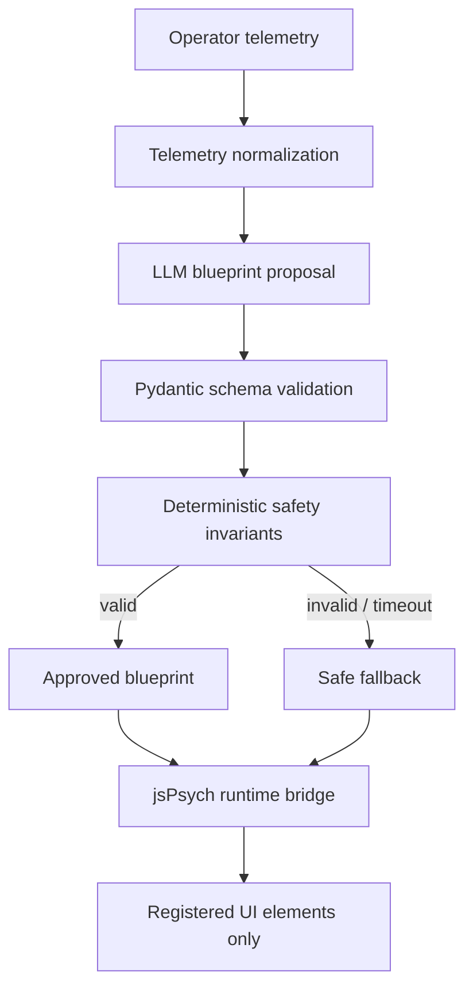

# Cognisynth
### Deterministic Safety-Gated Cognitive UI Synthesis

Cognisynth is a research prototype for translating operator telemetry into candidate adaptive user-interface blueprints, then applying deterministic validation before a runtime is allowed to mutate the interface.

**Research premise:** an LLM may propose an interface; it must not be the final safety authority. The validator checks the proposal against explicit invariants and returns a conservative fallback whenever validation fails.

> **Research prototype only.** This repository is not certified for clinical, aviation, industrial, emergency-response, or other safety-critical deployment. Synthetic results are demonstrations, not evidence of real-world efficacy.

## Architecture



## Repository layout

- `core/cognitive_compiler.py` — telemetry model, panic-index calculation, structured blueprint proposal, timeout/staleness handling.
- `safety/formal_validator.py` — typed blueprint schema, deterministic safety invariants, violation ledger, fallback blueprint.
- `core/jspsych_runtime_bridge.js` — client-side adapter that only targets pre-registered DOM identifiers.
- `tests/telemetry_simulator.py` — reproducible synthetic calm/escalation/recovery telemetry.
- `tests/test_validator.py` — offline regression tests.
- `synthetic_telemetry.jsonl` — example generated telemetry.
- `BUILD_MANIFEST.json` — build and verification notes.

## Quick start

Python 3.10+ is recommended.

```bash
python -m venv .venv
# Windows PowerShell: .venv\Scripts\Activate.ps1
# macOS/Linux: source .venv/bin/activate
pip install -r requirements.txt
python -m unittest discover -s tests -v
python -m safety.formal_validator
python -m tests.telemetry_simulator --samples 30 --rate 10 --seed 7
node --check core/jspsych_runtime_bridge.js
```

The offline validator and tests do not require an API key. Live compiler calls require `OPENAI_API_KEY` in the environment. Never commit credentials or a real `.env` file.

## Safety invariants

The validator is intended to enforce properties such as:

- Critical controls remain visible and reachable.
- Proposed render budgets are bounded by the 16.67 ms frame target.
- Interaction friction is constrained and never added to critical controls.
- Asynchronous blocking behavior is rejected.
- Navigation graph reachability and interface-density limits are checked.
- Invalid proposals, schema failures, stale telemetry, or model errors fail closed to a deterministic fallback.
- A calibrated visual entropy proxy is calculated as:

```python
def visual_entropy_index(blueprint: UIBlueprint) -> float:
    visible_elements = len(blueprint.visible_controls) + len(blueprint.visible_streams)
    edge_count = sum(len(targets) for targets in blueprint.navigation_graph.values())
    collapsed_count = len(blueprint.collapsed_streams)
    return (
        0.35 * math.log2(1 + visible_elements)
        + 0.10 * math.log2(1 + edge_count)
        + 0.05 * math.log2(1 + collapsed_count)
    )
```

This index is a heuristic proxy, not a validated measure of cognitive load. Its coefficients and thresholds require empirical calibration.

## Design boundaries

1. **Proposal is not permission.** Model output is untrusted input.
2. **No generated code execution.** The runtime bridge maps validated identifiers to pre-registered elements; it must never evaluate model-authored JavaScript or HTML.
3. **Fail closed.** If a proposal cannot be proven to satisfy the implemented invariants, use the fallback.
4. **Synthetic data only.** Do not put identifiable or sensitive operator telemetry into the demo.
5. **Independent validation required.** Unit tests do not prove correctness, usability, or safety under real operational conditions.

## Research questions

- Can deterministic validation reduce unsafe interface mutations compared with unconstrained LLM-driven adaptation?
- Which telemetry features are robust indicators of acute operator overload?
- Does the visual entropy proxy correlate with measured task performance and workload?
- What are the latency, false-positive, and false-negative trade-offs of a fail-closed runtime?

## Limitations

This implementation is a reproducible research scaffold, not a formal proof of system safety. The LLM output, telemetry assumptions, UI element registry, browser environment, and human-factors hypotheses all require independent evaluation. Any claims about improved performance must be supported by preregistered experiments and measured results.

## License

No license has been selected yet. Until a license is added, normal copyright restrictions apply.
